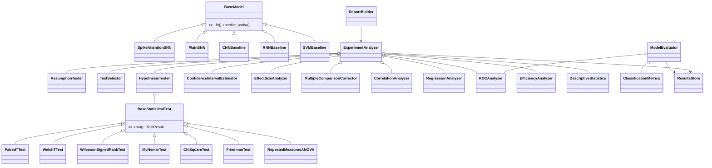

# SPIKE-ATTENTION — Software Architecture

This document describes **how** SPIKE-ATTENTION is built. The **what** is in `prd.md`; a visual map is in `arch.mmd`. Status: design only. Nothing here has been implemented or measured.

---

## 1. Architecture Overview

Two coupled subsystems share one results store:

1. **Predictive subsystem**: data → preprocessing → spike encoding → models (ST-SNN + 4 baselines) → training → cross-validated out-of-fold predictions.
2. **Inferential subsystem**: `ExperimentAnalyzer` reads *only stored artifacts* (out-of-fold predictions, per-patient metrics, efficiency measurements) and runs the ISPA statistical modules.

The **only coupling** between them is the on-disk results contract (Section 9). This guarantees that statistics are computed from actual experimental outputs, can be re-run without retraining, and can be unit-tested with fixtures.

```text
raw ECG → Preprocessing → Spike Encoding → ST-SNN / baselines → OOF predictions
                                                                     │  (results contract)
                                                                     â–¼
                       ModelEvaluator → per-patient/fold/seed/pooled metrics
                                                                     â–¼
                  ExperimentAnalyzer → assumptions → tests → CIs → effect sizes
                                      → corrections → interpretation → plots → report
```

## 2. Design Principles

1. **Statistical unit first**: every API that consumes scores declares its unit (`patient`, `seed`, `fold`, `beat`); beat-level inference is opt-in and flagged exploratory.
2. **No leakage by construction**: splitting happens once, in `PatientSplitter`, which returns immutable partitions with asserted disjointness; fitted preprocessors receive only training patients.
3. **Results contract**: modelling code writes; analysis code reads. No analysis code imports a model.
4. **Assumptions are first-class**: tests declare assumptions; the analyzer checks them and records the outcome next to the result.
5. **Pre-specification**: test families, alpha, SESOI, selection rules live in YAML and are hashed in the manifest.
6. **Composition over inheritance**: inheritance only for `BaseStatisticalTest`, `BaseModel`, `BaseSpikeEncoder`, `BaseAnalyzer`.
7. **Honest reporting**: reports are generated from data; templates contain no numeric literals.

## 3. Technology Choices

| Choice | Justification |
|---|---|
| Python 3.11 | Required stack; mature scientific ecosystem |
| NumPy / Pandas | Array and tabular storage of metrics and predictions |
| SciPy | Reference distributions/tests (used to verify our implementations; wrappers where appropriate) |
| statsmodels | OLS diagnostics, `AnovaRM`, power analysis, multiple-comparison reference |
| scikit-learn | SVM, stratified group K-fold, metric cross-checks |
| PyTorch | Deep models, surrogate gradients |
| **Custom LIF in PyTorch (default)** vs SpikingJelly/snnTorch | Custom code makes the LIF equation and surrogate gradient transparent and auditable for an academic report, avoids framework-version coupling, and the layer set is small. SpikingJelly is kept as an *optional cross-check* of our LIF dynamics in a unit test. |
| Matplotlib / Seaborn | Figures as PNG |
| WFDB | Official-format MIT-BIH access |
| PyYAML | Configuration |
| pytest | Testing |
| Parquet/CSV/JSON | Local artifacts, no SQL (Parquet optional via `pyarrow`; CSV fallback) |

Statistical implementation policy: core formulas for t-tests, effect sizes, Wilson/bootstrap CIs, corrections, McNemar and metrics are **implemented in our classes** (NumPy/SciPy distributions for p-value lookup) and **verified by tests against SciPy/statsmodels**. Tests with complex theory (sphericity assessment, Friedman post-hoc, RM-ANOVA) wrap statsmodels/SciPy with a validated interface.

## 4. Folder Structure

```text
spike-attention/
├── configs/
│   ├── dataset.yaml            # records, window, filters, split policy, exclusions
│   ├── label_mapping.yaml      # beat symbol → AAMI class
│   ├── models/                 # snn.yaml, st_snn.yaml, cnn.yaml, rnn.yaml, svm.yaml
│   ├── experiment.yaml         # K, seeds, HPO budget, device
│   ├── analysis.yaml           # alpha, SESOI, families, selection rules, bootstrap B
│   └── efficiency.yaml         # profiling and energy-estimate constants
├── data/{raw,processed,metadata}/
├── src/
│   ├── data/                   # mitdb_downloader, record_catalog, label_mapping, patient_splitter, dataset
│   ├── preprocessing/          # filters, normalization, segmentation, pipeline
│   ├── encoding/               # base_encoder, delta_encoder, rate_encoder (optional)
│   ├── models/
│   │   ├── base_model.py
│   │   ├── snn/                # lif, surrogate, spiking_conv, attention, st_snn, plain_snn
│   │   └── baselines/          # svm_baseline, cnn_baseline, rnn_baseline
│   ├── training/               # trainer, losses, seed, hpo
│   ├── prediction/             # predictor
│   ├── evaluation/             # cross_validation, model_evaluator, results_store, efficiency_profiler
│   ├── statistics/
│   │   ├── base.py             # BaseStatisticalTest, TestResult, Hypothesis
│   │   ├── descriptive_statistics.py
│   │   ├── hypothesis_testing.py
│   │   ├── ttest.py
│   │   ├── chi_square.py
│   │   ├── anova.py
│   │   ├── nonparametric_tests.py
│   │   ├── mcnemar_test.py
│   │   ├── confidence_intervals.py
│   │   ├── effect_size.py
│   │   ├── correlation.py
│   │   ├── regression.py
│   │   ├── classification_metrics.py
│   │   ├── roc.py
│   │   ├── multiple_comparison.py
│   │   ├── assumption_tests.py
│   │   ├── efficiency_analysis.py
│   │   ├── test_selector.py
│   │   └── experiment_analyzer.py
│   ├── visualization/          # distribution_plots, performance_plots, inference_plots, efficiency_plots
│   ├── reporting/              # report_builder, templates/
│   └── utils/                  # config, logging_setup, io, hashing, reproducibility
├── experiments/                # run_experiment.py, sweep definitions
├── results/<run_id>/           # generated (git-ignored)
├── reports/                    # curated copies of final reports
├── tests/{unit,integration}/
├── main.py                     # CLI
├── requirements.txt  .env.example  .gitignore
└── prd.md  arch.md  arch.mmd  README.md
```

Note: a package named `statistics` would shadow the Python standard library when `src/` is on `sys.path`. Implementation uses the package name `spikeattn` (`src/spikeattn/...`) and the folder `statistics/` is imported as `spikeattn.statistics`; absolute imports only. (This refines the suggested layout, deliberately.)

## 5. Module Responsibilities

| Package | Responsibility |
|---|---|
| `data` | Download/verify, catalog (CSV), AAMI label mapping, patient-group assignment (201+202), `PatientSplitter`, `BeatDataset` |
| `preprocessing` | `BandpassFilter` (Butterworth, `sosfiltfilt`), `LeadNormalizer` (fit on train only), `BeatSegmenter`, `PreprocessingPipeline` |
| `encoding` | `BaseSpikeEncoder`; `DeltaSpikeEncoder` (ON/OFF threshold crossings), optional `RateEncoder` |
| `models` | `BaseModel`; ST-SNN, plain SNN, CNN, RNN, SVM |
| `training` | `Trainer` (loop, early stopping on validation), `ClassWeightedCrossEntropy`, `HyperparameterTuner`, seeding |
| `prediction` | `Predictor` → `PredictionBundle` (probabilities, labels, patient/beat ids) |
| `evaluation` | `PatientGroupCrossValidator`, `ModelEvaluator`, `ResultsStore`, `EfficiencyProfiler` |
| `statistics` | All ISPA classes and the `ExperimentAnalyzer` |
| `visualization` | Pure functions/classes that take result tables and write PNGs |
| `reporting` | `ReportBuilder` (Markdown from `AnalysisBundle`) |
| `utils` | Config loading/validation, logging, I/O, hashing, run manifest |

## 6. Model Architecture and Equations

### 6.1 Pipeline stages

1. **Input**: `x ∈ ℝ^{2×L}` (two leads, L = window length, default 360 samples at 360 Hz).
2. **Preprocessing**: 4th-order Butterworth bandpass 0.5–40 Hz (zero-phase) → per-lead z-score with train-patient statistics → beat-centred window.
3. **Spike encoding (default: delta/threshold)**. For each lead, with step threshold θ_enc:
   `ON[t] = 1 if x[t] − ref[t−1] ≥ θ_enc`, `OFF[t] = 1 if ref[t−1] − x[t] ≥ θ_enc`; `ref[t] = ref[t−1] ± θ_enc` on a spike, else unchanged. Output `S ∈ {0,1}^{T×4×...}` (2 leads × ON/OFF). θ_enc is set from training-set signal statistics (e.g., a fraction of the training SD of per-sample differences) and logged. Optional time-stride downsampling reduces T. Rationale: delta encoding is event-driven and preserves morphology; its limitation is sensitivity to θ_enc and noise (hence the filtering step). Rate/latency encoders are alternatives and are *not* in the first release.
4. **Spiking feature extraction**: `SpikingConv1d → LIF` blocks (2–3 blocks, batch-norm optional, pooling between blocks).
5. **Spatio-temporal attention** (Section 6.3).
6. **Head**: global average pool over time → dropout → FC → logits → softmax.

### 6.2 LIF neuron

Continuous: `τ dV/dt = −(V − V_reset) + R·I(t)`; spike when `V > V_th`; then `V ← V_reset`.

Discrete (Euler, step Δt):
`V[t] = V[t−1] + (Δt/τ)·(−(V[t−1] − V_reset) + R·I[t])`
`S[t] = Θ(V[t] − V_th)`
`V[t] ← V[t]·(1 − S[t]) + V_reset·S[t]` (hard reset)

Surrogate gradient for backprop: `∂S/∂V ≈ (α/2) / (1 + (π α (V − V_th)/2)²)` (arctan), α configurable. Training: unrolled over T steps, cross-entropy on time-averaged logits.

### 6.3 Attention adapted to the spiking representation

Spiking layers output a spike tensor `S ∈ {0,1}^{B×T×K×F}` (K = leads, F = channels). Softmax attention is not spike-friendly, so the design is **hybrid**:

- Convert spikes to real-valued features by a short causal **exponential trace** (or the membrane potential): `Z[t] = λ Z[t−1] + S[t]`, giving `Z ∈ ℝ^{B×T×K×F}`.
- **Temporal attention**: for each lead, treat time steps as tokens. `Q = Z W_Q`, `K = Z W_K`, `V = Z W_V`, `A = softmax(Q Kᵀ / √d_k)`, output `A V` of shape `B×T×F`. Optional causal or banded mask for efficiency.
- **Inter-lead attention**: at each time step (or each pooled time bin), the K leads are tokens: `Q,K,V ∈ ℝ^{B×T×K×d}`, `A = softmax(QKᵀ/√d_k)` over the lead axis (2×2 attention map per step). The attention maps are retained for inspection.
- The two modules are applied in sequence (temporal then inter-lead), with residual connections and layer norm. The ablation order and single-module variants are exploratory.
- Honest consequence: attention MACs are dense real-valued operations. Energy estimates treat them as MACs, not accumulates (Section 12).

### 6.4 Baselines

- **SVM**: RBF SVM on features (wavelet or morphology features per lead, RR-interval features, both leads concatenated); `class_weight='balanced'`; features scaled on train only; `probability=True` (Platt) for ROC and calibration.
- **CNN**: 1-D conv stack on the filtered 2-channel window; parameter budget matched to ST-SNN within a documented tolerance.
- **RNN**: GRU (LSTM optional) on the filtered window, budget matched.
- **Plain SNN**: same encoder/spiking conv/LIF/head as ST-SNN with the attention modules removed (otherwise identical).

All implement `BaseModel`.

## 7. OOP Class Design

### 7.1 Core abstractions

```python
@dataclass(frozen=True)
class Hypothesis:           # H0/H1 text, tail ('two-sided'|'greater'|'less'), alpha
@dataclass(frozen=True)
class TestResult:           # name, statistic, df, p_value, alpha, reject_h0, critical_region,
                            # effect_size, ci, n, unit, assumptions: dict, interpretation: str
class BaseStatisticalTest(ABC):
    def run(self, *data, hypothesis: Hypothesis) -> TestResult:   # template method
        self.validate_input(*data)
        assumptions = self.check_assumptions(*data)
        stat, df, p = self.compute(*data, hypothesis=hypothesis)
        return self.interpret(stat, df, p, assumptions, hypothesis)
    # abstract: validate_input, check_assumptions, compute; concrete: interpret helper
class BaseModel(ABC):       # fit(X, y, val=None), predict_proba(X), predict(X), count_parameters(), name
class BaseSpikeEncoder(ABC) # fit(X_train), encode(X) -> spikes, params() -> dict
class BaseAnalyzer(ABC)     # run(inputs) -> dataclass result, to_dict()
```

### 7.2 Statistical classes

| Class | Key methods | Notes |
|---|---|---|
| `DescriptiveStatistics` | `summarize(x)`, `mode(x)`, `quartiles(x)`, `iqr(x)`, `class_distribution(y)`, `summarize_frame(df, by)` | Returns tidy DataFrames |
| `HypothesisTester` | `test(name, data, hypothesis)`, `critical_region(df, alpha, tail, dist)`, `power_analysis(effect, n, alpha, tail)`, `min_detectable_effect(n, alpha, power)`, `type_errors_summary(result)` | Registry of `BaseStatisticalTest` subclasses; `ExperimentAnalyzer` calls it |
| `OneSampleTTest`, `IndependentTTest`, `WelchTTest`, `PairedTTest`, `CorrectedResampledTTest` | `run` | Corrected test uses `t = mean(d) / sqrt((1/k + n_test/n_train)·var(d))` (Nadeau–Bengio) |
| `ChiSquareTest` | `independence(table)`, `goodness_of_fit(obs, exp)` | Checks expected-count rule, returns Cramér's V |
| `OneWayANOVA`, `RepeatedMeasuresANOVA` | `run`, `post_hoc` | RM-ANOVA: sphericity assessment + Greenhouse–Geisser |
| `WilcoxonSignedRankTest`, `FriedmanTest`, `KruskalWallisTest` | `run`, `post_hoc` | Friedman post-hoc via pairwise Wilcoxon + correction |
| `McNemarTest` | `run(correct_a, correct_b)` | Exact binomial for small discordant counts, otherwise χ² with continuity correction |
| `ConfidenceIntervalEstimator` | `wilson(k, n, level)`, `normal(mean, se, level)`, `bootstrap(data, stat_fn, cluster_ids, B, method)`, `difference_ci(a, b, paired, cluster_ids)` | Cluster (patient) bootstrap resamples patients with replacement |
| `EffectSizeAnalyzer` | `cohens_d`, `paired_d`, `hedges_g`, `rank_biserial`, `kendalls_w`, `cramers_v`, `eta_squared`, `with_ci(...)`, `interpret(magnitude)` | Magnitude labels are conventions, reported alongside SESOI |
| `CorrelationAnalyzer` | `pearson`, `spearman`, `matrix(df, method)`, `significance_matrix(...)` | Corrected p-values via corrector |
| `RegressionAnalyzer` | `fit_simple`, `fit_multiple`, `diagnostics(model)`, `summary` | Wraps statsmodels OLS; own R²/adj-R² for verification; cluster-robust SE option |
| `ClassificationMetrics` | `confusion_matrix`, `per_class_counts` (TP/TN/FP/FN), `accuracy`, `precision`, `recall`, `specificity`, `f1`, `macro_f1`, `weighted_f1`, `balanced_accuracy`, `report` | NumPy implementation, cross-checked with sklearn |
| `ROCAnalyzer` | `curve(y_true, scores)`, `one_vs_rest(...)`, `area(...)`, `thresholds(...)`, `youden(...)` | One-vs-rest default; absent-class handling documented |
| `MultipleComparisonCorrector` | `bonferroni(p)`, `holm(p)`, `benjamini_hochberg(p)`, `correct(p, method, families)` | Receives a collection of p-values with family labels |
| `AssumptionTester` | `shapiro_wilk`, `levene`, `outliers(iqr|robust_z)`, `qq_data`, `sphericity`, `independence_notes` | Returns verdicts worded as "no evidence against…", never "is normal" |
| `EfficiencyAnalyzer` | `summarize(measurements)`, `compare(models)`, `energy_estimate(counts, constants)`, `relate_to_performance(...)` | Separates `measured` and `estimated` fields in every record |
| `TestSelector` | `select_paired(diffs, assumptions)`, `select_groups(...)` | Implements pre-specified rules from `analysis.yaml` |
| `ExperimentAnalyzer` | `load()`, `describe()`, `check_assumptions()`, `compare_models()`, `intervals()`, `effects()`, `correct()`, `relationships()`, `efficiency()`, `interpret()`, `report()` | Orchestrator (Section 8) |

Evaluation/other classes: `PatientSplitter`, `PatientGroupCrossValidator`, `ModelEvaluator`, `Predictor`, `ResultsStore`, `EfficiencyProfiler`, `Trainer`, `HyperparameterTuner`, `ReportBuilder`, `Plotter` family.

### 7.3 Class relationships



## 8. Statistical Analysis Flow (`ExperimentAnalyzer`)

1. **Load** (`ResultsStore`): OOF predictions → `ModelEvaluator` outputs per-patient, per-fold, per-seed and pooled metric tables, in tidy format `(model, seed, fold, patient_id, metric, value)`.
2. **Describe** (`DescriptiveStatistics`): class distribution per split; per-metric distributions; per-model summaries.
3. **Assumptions** (`AssumptionTester`): on each paired-difference vector: Shapiro–Wilk, outlier screen, Q-Q data; Levene for group comparisons; sphericity for RM-ANOVA.
4. **Select tests** (`TestSelector`): pre-specified rule. Example: normality not rejected and no extreme outliers → paired t; else Wilcoxon. Both are computed and stored; the selected one is flagged confirmatory.
5. **Test** (`HypothesisTester` → test classes): primary family (4 paired comparisons), secondary (Friedman/RM-ANOVA, post-hoc), exploratory (McNemar, chi-square, one-way ANOVA).
6. **Intervals** (`ConfidenceIntervalEstimator`): patient-clustered bootstrap CIs for each model's metrics and for each paired difference; Wilson CIs for single proportions with dependence caveat.
7. **Effect sizes** (`EffectSizeAnalyzer`): paired d_z/Hedges' g or rank-biserial matching the selected test; CIs by bootstrap; comparison with SESOI.
8. **Correct** (`MultipleComparisonCorrector`): Holm on primary family; BH on secondary family; adjusted p-values stored next to raw p-values.
9. **Relationships**: `CorrelationAnalyzer` (cost vs performance, patient features vs scores), `RegressionAnalyzer` (explanatory regression + diagnostics).
10. **ROC** (`ROCAnalyzer`): one-vs-rest ROC Curves, per-class AU (Area Under the ROC Curve), macro AU with patient-clustered CI.
11. **Efficiency** (`EfficiencyAnalyzer`): measured vs estimated.
12. **Interpret**: rule-based text generator producing a sentence per result (decision, effect size magnitude, CI vs SESOI, caveats); no results are hard-coded.
13. **Report** (`ReportBuilder` + visualization): `AnalysisBundle` → JSON, CSV, PNG, Markdown.

### Pairing construction
`score[p, m] = mean_over_seeds( balanced_accuracy_on_patient_p_OOF[m, seed] )`. Within a seed, each patient appears in exactly one outer test fold. All models share identical folds for the same seed. `d[p] = score[p, ST-SNN] − score[p, baseline]`. The vector `d` (length = number of patient groups) is the input to paired tests.

## 9. Data Flow, Experiment Management and Result Storage

### Data flow
`data/raw` → `PreprocessingPipeline` → `data/processed/beats_<dataset_hash>.npz` (+ `beats_meta.csv` with beat id, patient group, record, class, R-peak index) → `PatientSplitter` → models.

### Experiment run
`main.py experiment run` creates `results/<run_id>/` where `run_id = <UTC timestamp>_<config_hash8>`.

```text
results/<run_id>/
├── manifest.json          # configs, config hash, seeds, package versions, git commit, hardware
├── splits/                # seed_<s>_fold_<k>.json (train/val/test patient group ids)
├── models/                # checkpoints (optional)
├── predictions/           # <model>_seed<s>.csv: beat_id, patient_group, fold, y_true, p_N, p_S, p_V, p_F, p_Q
├── tuning/                # HPO trials per model/fold
├── metrics/               # per_patient.csv, per_fold.csv, per_seed.csv, pooled.csv
├── efficiency/            # measurements.csv
├── statistics/            # *.json, *.csv (every test's TestResult)
├── figures/               # *.png
├── reports/report.md
└── logs/run.log
```

Runs are resumable: each (model, seed, fold) job writes a completion marker; completed jobs are skipped.

### Configuration management
YAML files validated by dataclass schemas in `utils/config.py`; CLI flags override; `.env.example` holds only paths/device defaults. The merged config is dumped into the manifest.

## 10. Predictive Pipeline and Training Flow

```text
for seed in seeds:
  folds = PatientGroupCrossValidator(K, seed).split(patient_groups, class_profile)
  for fold in folds:
     train_p, test_p = folds[fold]
     train_p, val_p = PatientSplitter.inner_split(train_p, seed)      # patient-wise
     assert disjoint(train_p, val_p, test_p)
     prep.fit(train_p)           # normalization/encoder threshold fitted here only
     for model in [SVM, CNN, RNN, PlainSNN, STSNN]:
         best_cfg = HyperparameterTuner.search(model, train_p, val_p)
         model.fit(train_p, val_p, best_cfg)
         bundle = Predictor(model).predict(test_p)
         ResultsStore.save(bundle)
```

Training specifics: Adam; class-weighted cross-entropy (weights from training-fold class frequencies); early stopping on validation loss/balanced accuracy; fixed seeds (`random`, `numpy`, `torch`, dataloader generator); optional mixed precision off by default for determinism; time-stepped forward for SNNs with surrogate gradients; gradient clipping.

HPO: small random search, same number of trials per model, validation only. To limit cost, HPO may run on the first fold of each seed and reuse the selected configuration (documented design choice in config; validity noted in the report since fold-1 test patients are excluded from that search only if search uses fold-1 training patients — implementation keeps this by running search inside each fold's training portion when budget allows).

## 11. Error Handling and Logging

- **Fail fast with typed exceptions**: `LeakageError`, `ConfigError`, `AssumptionViolationWarning` (non-fatal, recorded), `InsufficientDataError` (e.g., fewer than 3 pairs), `UnsupportedTestError`.
- Statistical classes never silently fall back: when a requirement fails, the result is flagged `valid=False` with reason, or an alternative test is chosen *and the substitution is logged*.
- Degenerate cases handled explicitly: zero variance, all-zero differences (Wilcoxon), absent class in ROC, empty contingency cells.
- Logging: Python `logging`, console (INFO) + `logs/run.log` (DEBUG), JSON-lines option; each stage logs config hash, seed, split sizes, class counts, leakage assertion outcome.

## 12. Computational Efficiency Methodology

| Quantity | Method | Type |
|---|---|---|
| Inference latency | Warm-up then median/IQR over R repetitions, batch size 1 and fixed batch, `torch.cuda.synchronize` when GPU, CPU thread count fixed and recorded | **Measured** |
| Training time | Wall-clock per fold with identical epochs policy reported | **Measured** |
| Parameter count | `count_parameters()` (SVM: support-vector count and feature dimension reported separately) | **Measured** (exact) |
| Peak memory | `tracemalloc`/`torch.cuda.max_memory_allocated`/process RSS | **Measured** |
| Spike activity | Mean firing rate per layer on test data, sparsity | **Measured** |
| Operation counts | MACs (dense layers, attention, encoder-input layer) and SynOps (`spikes × fan-out`) via counters/hooks | **Computed** from model and measured spikes |
| Energy | `E ≈ MACs·E_MAC + SynOps·E_AC` with literature constants in `efficiency.yaml` | **Estimated** (assumption-based; ignores memory movement and hardware specifics) |

Every record carries `kind ∈ {measured, computed, estimated}`; reports and plots label estimated energy explicitly and never present it as a measured saving. Direct power measurement (e.g., an external meter or RAPL counters, where available) is optional and, if used, reported separately. Efficiency differences across seeds/folds get the same CI/effect-size treatment.

## 13. Testing Strategy

| Level | Content |
|---|---|
| Unit: statistics | Each class vs SciPy/statsmodels/sklearn on fixed random arrays and textbook examples; edge cases (ties, zero variance, tiny n); Wilson/bootstrap coverage sanity via simulation; Type I error rate of tests under simulated H0 within tolerance |
| Unit: metrics | Hand-computed confusion matrices; macro/weighted F1 vs sklearn; ROC Curve vs sklearn; AU (Area Under the ROC Curve) sanity (perfect, random, inverted scores) |
| Unit: data | Label mapping coverage; **leakage tests** (patient groups disjoint; 201/202 same group; normalizer fitted on train only) |
| Unit: models | Shape tests, LIF dynamics vs analytic step response, surrogate gradient non-zero, determinism under fixed seed, `BaseModel` contract |
| Integration | Tiny synthetic fixtures (clearly labelled test fixtures, not results) run the full `ExperimentAnalyzer`; mini end-to-end run on 2 records per fold |
| Reproducibility | Same seed → same splits and metrics (CPU) |
| Policy tests | Grep-style test: no forbidden terminology (the prohibited ROC-area abbreviation) anywhere in the repository; no numeric result literals in report templates |

## 14. Performance and Scalability

- Preprocessed beats cached as compressed arrays (~100k beats × 2 × 360 floats ≈ well under a few GB in float32); memory-mapped loading.
- SNN training cost scales with T × batch; mitigate with time-stride downsampling, small channel widths, mixed precision as optional.
- Bootstrap cost scales with B × number of metrics; patients are the resampling unit (≈45), so cheap; vectorized with NumPy; optional multiprocessing.
- Jobs (model × seed × fold) are independent → trivially parallel via a process pool or external scheduler; resumable markers provide fault tolerance.
- Future scale-out: additional databases (add a dataset adapter implementing the catalog/beat contract), more models (register a `BaseModel`).

## 15. How the SNN and the ISPA Pipeline Integrate

1. Every model, including ST-SNN, exposes the same `predict_proba` contract, so the analysis layer is model-agnostic.
2. The model's randomness (seeds) and the data's randomness (fold assignment) are explicit experimental factors, so variance sources are analysable.
3. Per-patient out-of-fold scoring converts beat-level predictions into the independent unit that inferential tests need.
4. Efficiency measurements are first-class results alongside accuracy, enabling cost-vs-performance correlation/regression.
5. Attention maps and spike statistics are persisted so they can be summarized descriptively (e.g., distribution of lead-attention weights by class) as exploratory material.
6. `ExperimentAnalyzer` is the single consumer; adding a model automatically extends the comparison family, and the corrector's family size updates from configuration, preventing silent multiple-testing inflation.
