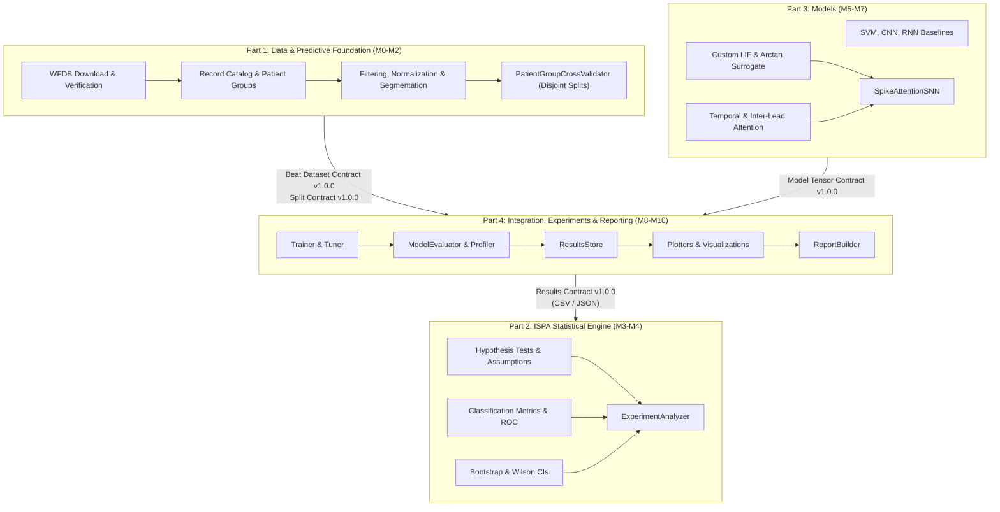

# SPIKE-ATTENTION — Implementation Parts and Frozen Interface Contracts

## 1. Document Scope and Architectural Conflicts Resolution

This document governs the modular implementation of **SPIKE-ATTENTION** (A Hybrid Spatio-Temporal Attention Spiking Neural Network for Two-Channel ECG Analysis, for Inferential Statistics and Predictive Analysis).

### Conflicts with Design Documents and Explicit Resolutions

1. **Milestone Sequencing vs. 4-Part Boundary**:
   - *Design Document*: `IMPLEMENTATION_KICKOFF_PROMPT.md` and `prd.md` list linear milestones M0 through M10 (M0–M2: Data, M3–M4: Statistics, M5–M7: Models, M8–M10: Training & Reporting).
   - *Conflict*: Linear execution tightly couples statistical development with prior model implementation or forces premature integration.
   - *Explicit Resolution*: The codebase is partitioned into four decoupled parts:
     - **Part 1**: Data and Predictive Foundation (M0–M2)
     - **Part 2**: ISPA Statistical Engine (M3–M4)
     - **Part 3**: Models (M5–M7)
     - **Part 4**: Training, Experiments, Efficiency, Visualization, and Reporting (M8–M10)
     Parts 2 and 3 depend strictly on frozen contracts, can be implemented and tested in parallel using synthetic fixtures and random tensors, and must never import cross-part code. Part 4 is the sole integration boundary.

2. **Package Layout and Namespace Collision**:
   - *Design Document*: `arch.md` folder tree shows `src/statistics/`, which would shadow Python's standard library `statistics` module when `src/` is in `sys.path`.
   - *Explicit Resolution*: The Python package root is `src/spikeattn/`. All imports are absolute: `import spikeattn.statistics...`. No subpackage is exposed top-level in `src/`.

3. **Normalization and Data Leakage Prevention**:
   - *Design Document*: `arch.md` Section 9 describes `data/processed/beats_<dataset_hash>.npz` as preprocessed beats.
   - *Conflict*: If global caching performs z-score normalization across all records, information from test patients leaks into training folds.
   - *Explicit Resolution*: The globally cached `beats_<dataset_hash>.npz` stores bandpass-filtered, beat-centred raw amplitude signals. Z-score normalization (`LeadNormalizer`) is fitted strictly on training patient groups within each cross-validation fold during training/evaluation in Part 4.

4. **Spike Tensor Dimension Standard**:
   - *Design Document*: `arch.md` Section 6.3 notes $S \in \{0, 1\}^{B \times T \times K \times F}$.
   - *Explicit Resolution*: For two-channel ECG with dual ON/OFF delta encoding, the tensor is standardized to $[B, T, 4]$ where the 4 channels correspond to:
     - Channel 0: Lead 0 ON
     - Channel 1: Lead 0 OFF
     - Channel 2: Lead 1 ON
     - Channel 3: Lead 1 OFF
     Any conversion to spatial/lead dimensions $[B, T, 2, 2]$ is performed internally by the model if required.

5. **Terminology Governance (ROC Metric Abbreviation)**:
   - *Design Document*: The PRD and Kickoff prompt forbid the 3-letter abbreviation for Area Under the ROC Curve.
   - *Explicit Resolution*: The token is prohibited across all code, tests, configs, comments, docstrings, filenames, and reports. All interfaces use `ROC Curve` and `AU (Area Under the ROC Curve)`. A repository-wide scanner test `tests/unit/test_policy_terminology.py` enforces this with zero exceptions.

---

## 2. Overview of Implementation Parts

| Part | Title | Milestones | Depends On (Frozen Contracts) | Blocks | Estimated Size |
|---|---|---|---|---|---|
| **Part 1** | Data and Predictive Foundation | M0, M1, M2 | None (Self-contained foundation) | Part 3, Part 4 | ~22 files, ~3,500 LOC |
| **Part 2** | ISPA Statistical Engine | M3, M4 | Results Contract v1.0.0 (Synthetic Fixtures) | Part 4 | ~20 files, ~4,500 LOC |
| **Part 3** | Models and Neural Baselines | M5, M6, M7 | Model Tensor Contract v1.0.0 | Part 4 | ~16 files, ~3,000 LOC |
| **Part 4** | Training, Experiments & Reporting | M8, M9, M10 | Beat Dataset v1, Split v1, Tensor v1, Results v1 | Delivery | ~22 files, ~4,000 LOC |

---

## 3. Frozen Interface Contracts

All contracts are versioned `1.0.0` and immutable.

### 3.1 Beat Dataset Contract v1.0.0 (Part 1 $\rightarrow$ Parts 3 & 4)

#### File Structure & Formats
1. **Array File**: `data/processed/beats_<dataset_hash>.npz`
   - Compressed archive (`numpy.savez_compressed`).
   - Keys and specifications:
     - `signals`: `numpy.ndarray`, shape `(N, 2, L)`, dtype `float32`. Bandpass filtered (0.5–40 Hz), zero-phase, unnormalized. $L = 360$ (1 second at 360 Hz). Lead 0 is first lead (usually MLII), Lead 1 is second lead (usually V1/V5).
     - `labels`: `numpy.ndarray`, shape `(N,)`, dtype `int64`. Values $\in \{0, 1, 2, 3, 4\}$.
     - `patient_group_ids`: `numpy.ndarray`, shape `(N,)`, dtype `<U16` (e.g. `'mitdb:100'`, `'mitdb:201-202'`).
     - `beat_ids`: `numpy.ndarray`, shape `(N,)`, dtype `<U32` (format: `<record_id>:<sample_idx>:<ordinal>`).
     - `r_peak_indices`: `numpy.ndarray`, shape `(N,)`, dtype `int64`. Window-relative index of the R-peak (default $L // 2 = 180$).
2. **Metadata Companion**: `data/processed/beats_meta.csv`
   - UTF-8 CSV, comma-separated, with header, exactly $N$ rows matching `signals` row-for-row.
   - Required columns and dtypes:
     - `beat_id`: `string` (unique identifier)
     - `record_id`: `string` (3-digit string, e.g. `'100'`, `'201'`)
     - `patient_group_id`: `string` (e.g. `'mitdb:100'`, `'mitdb:201-202'`)
     - `annotation_sample`: `int64` (absolute sample index in original WFDB record)
     - `symbol`: `string` (original WFDB beat annotation symbol, e.g. `'N'`, `'L'`, `'R'`, `'V'`)
     - `class_name`: `string` (AAMI EC57 class name: `'N'`, `'S'`, `'V'`, `'F'`, `'Q'`)
     - `class_id`: `int64` ($0 \dots 4$)
     - `r_peak_index`: `int64` (window-relative offset, typically 180)
     - `sampling_rate_hz`: `float64` (360.0)
     - `paced_record`: `bool` (`True` if record is in paced list, else `False`)

#### Label Encoding Order (AAMI EC57 Standard)
- Class 0: `N` (Normal / Bundle Branch Block beats)
- Class 1: `S` (Supraventricular ectopic beats)
- Class 2: `V` (Ventricular ectopic beats)
- Class 3: `F` (Fusion of ventricular and normal beats)
- Class 4: `Q` (Unknown / Paced beats)

#### Patient Group ID Format
- Individual subjects: `mitdb:<record_id>` (e.g., `mitdb:100`, `mitdb:101`).
- Merged subjects (Records 201 and 202 share the same patient): exactly `mitdb:201-202`.

---

### 3.2 Split Contract v1.0.0 (Part 1 $\rightarrow$ Part 4)

#### File Path
`data/processed/splits/seed_<seed>_fold_<fold>.json`

#### JSON Schema Specification
```json
{
  "$schema": "http://json-schema.org/draft-07/schema#",
  "title": "PatientGroupSplitContract",
  "version": "1.0.0",
  "type": "object",
  "required": [
    "schema_version",
    "seed",
    "fold",
    "n_splits",
    "dataset_hash",
    "train_patient_group_ids",
    "val_patient_group_ids",
    "test_patient_group_ids",
    "stratification"
  ],
  "properties": {
    "schema_version": { "type": "string", "enum": ["1.0.0"] },
    "seed": { "type": "integer", "minimum": 0 },
    "fold": { "type": "integer", "minimum": 0 },
    "n_splits": { "type": "integer", "minimum": 2 },
    "dataset_hash": { "type": "string", "pattern": "^[a-f0-9]{8,64}$" },
    "train_patient_group_ids": {
      "type": "array",
      "items": { "type": "string" },
      "uniqueItems": true
    },
    "val_patient_group_ids": {
      "type": "array",
      "items": { "type": "string" },
      "uniqueItems": true
    },
    "test_patient_group_ids": {
      "type": "array",
      "items": { "type": "string" },
      "uniqueItems": true
    },
    "stratification": {
      "type": "object",
      "required": ["method", "class_order", "group_class_profiles", "balance_note"],
      "properties": {
        "method": { "type": "string" },
        "class_order": { "type": "array", "items": { "type": "string" } },
        "group_class_profiles": {
          "type": "object",
          "additionalProperties": {
            "type": "object",
            "additionalProperties": { "type": "integer", "minimum": 0 }
          }
        },
        "balance_note": { "type": "string" }
      }
    }
  }
}
```

#### Disjointness Invariant
$$\text{train\_patient\_group\_ids} \cap \text{val\_patient\_group\_ids} = \emptyset$$
$$\text{train\_patient\_group\_ids} \cap \text{test\_patient\_group\_ids} = \emptyset$$
$$\text{val\_patient\_group\_ids} \cap \text{test\_patient\_group\_ids} = \emptyset$$
$$\text{train\_patient\_group\_ids} \cup \text{val\_patient\_group\_ids} \cup \text{test\_patient\_group\_ids} = \text{all\_eligible\_groups}$$

Violation raises `spikeattn.exceptions.LeakageError`.

---

### 3.3 Model Tensor Contract v1.0.0 (Part 3 $\leftrightarrow$ Part 4)

#### Input Tensor Specifications
1. **Real-Valued Signals**:
   - Shape: `[B, 2, L]`, where $B$ is batch size, 2 is lead dimension, $L = 360$ is window length.
   - Dtype: `torch.float32` (or `numpy.ndarray` float32 for classical estimators).
   - Values: Finite real numbers, normalized via training-fitted normalizer.
2. **Spike Tensors**:
   - Shape: `[B, T, 4]`, where $T$ is time steps ($T \le L$), 4 channels: `(lead0_ON, lead0_OFF, lead1_ON, lead1_OFF)`.
   - Dtype: `torch.float32`, values $\in \{0.0, 1.0\}$.
3. **Target Labels**:
   - Shape: `[B]`, dtype `torch.int64` (or `numpy.int64`), values $\in \{0, 1, 2, 3, 4\}$.

#### Model Interface (`BaseModel`)
```python
class BaseModel(ABC):
    @property
    @abstractmethod
    def name(self) -> str:
        """Unique model identifier (e.g. 'st_snn', 'svm', 'cnn')."""
        pass

    @abstractmethod
    def fit(
        self,
        X: np.ndarray | torch.Tensor,
        y: np.ndarray | torch.Tensor,
        val_data: tuple[np.ndarray | torch.Tensor, np.ndarray | torch.Tensor] | None = None,
    ) -> BaseModel:
        """Fit model on training set with optional validation data for early stopping."""
        pass

    @abstractmethod
    def predict_proba(self, X: np.ndarray | torch.Tensor) -> np.ndarray:
        """Return class probabilities of shape [B, 5] summing to 1.0 in order N, S, V, F, Q."""
        pass

    @abstractmethod
    def predict(self, X: np.ndarray | torch.Tensor) -> np.ndarray:
        """Return class index predictions of shape [B] in {0, 1, 2, 3, 4}."""
        pass

    @abstractmethod
    def count_parameters(self) -> int:
        """Return number of trainable parameters (0 for SVM)."""
        pass
```

#### Neural Network Logit Output
All PyTorch models expose `forward_logits(x: torch.Tensor) -> torch.Tensor` producing raw unnormalized logits of shape `[B, 5]`. `predict_proba` applies `softmax(dim=-1)`.

#### SVM Baseline Compatibility
`SVMBaseline` implements `BaseModel`. It receives real signals `[B, 2, L]`, extracts deterministic morphological and interval features (fitted solely on training data), runs `sklearn.svm.SVC(probability=True, class_weight='balanced')`, and returns probabilities `[B, 5]` and labels `[B]`. `count_parameters()` returns 0.

---

### 3.4 Results Contract v1.0.0 (Part 4 $\rightarrow$ Part 2)

All result files are stored in `results/<run_id>/`.

#### 1. Out-of-Fold Predictions: `predictions/<model>_seed<seed>.csv`
Headers: `beat_id,patient_group_id,record_id,seed,fold,model,y_true,y_pred,p_N,p_S,p_V,p_F,p_Q`
- `beat_id`: `string`
- `patient_group_id`: `string`
- `record_id`: `string`
- `seed`: `int64`
- `fold`: `int64`
- `model`: `string`
- `y_true`: `int64` ($0 \dots 4$)
- `y_pred`: `int64` ($0 \dots 4$)
- `p_N, p_S, p_V, p_F, p_Q`: `float64` $\in [0.0, 1.0]$, summing to $1.0 \pm 10^{-5}$.

#### 2. Per-Patient Metrics: `metrics/per_patient.csv`
Headers: `model,seed,fold,patient_group_id,n_beats,balanced_accuracy,accuracy`
- `model`: `string`
- `seed`: `int64`
- `fold`: `int64`
- `patient_group_id`: `string`
- `n_beats`: `int64`
- `balanced_accuracy`: `float64` (mean recall over classes present in that patient)
- `accuracy`: `float64`

#### 3. Per-Fold Metrics: `metrics/per_fold.csv`
Headers: `model,seed,fold,n_patients,n_beats,accuracy,balanced_accuracy,macro_f1,weighted_f1`
Types: `model:string`; `seed,fold,n_patients,n_beats:int64`; all four metrics `float64`.

#### 4. Per-Seed Metrics: `metrics/per_seed.csv`
Headers: `model,seed,n_patients,n_beats,accuracy,balanced_accuracy,macro_f1,weighted_f1`
Types: `model:string`; `seed,n_patients,n_beats:int64`; all four metrics `float64`.

#### 5. Pooled Metrics: `metrics/pooled.csv`
Headers: `model,n_patients,n_beats,accuracy,balanced_accuracy,macro_f1,weighted_f1`
Types: `model:string`; `n_patients,n_beats:int64`; all four metrics `float64`.

#### 6. Efficiency Measurements: `efficiency/measurements.csv`
Headers: `model,seed,fold,metric,value,unit,kind,method,device`
Types: `model,metric,unit,kind,method,device:string`; `seed,fold:int64`; `value:float64`.
- `kind`: Exactly one of `measured`, `computed`, `estimated`
- Example rows are generated only from actual measurements or computations; no illustrative values are stored in this specification.

#### 7. Manifest File: `manifest.json`
```json
{
  "schema_version": "1.0.0",
  "run_id": "string",
  "created_utc": "string",
  "dataset_hash": "string",
  "config_hash": "string",
  "class_order": ["N", "S", "V", "F", "Q"],
  "seeds": [0, 1, 2, 3, 4],
  "n_splits": 5,
  "models": ["svm", "cnn", "rnn", "plain_snn", "st_snn"],
  "package_versions": { "torch": "string", "numpy": "string", "scipy": "string" },
  "git_commit": "string_or_null",
  "hardware": { "device": "cpu", "cpu": "string", "gpu": "string_or_null" },
  "configs": { "dataset": {}, "experiment": {}, "analysis": {}, "efficiency": {} },
  "artifacts": { "path": { "sha256": "string", "bytes": "int64" } },
  "status": "complete"
}
```

---

## 4. Per-Part Detailed Specifications

### Part 1 — Data and Predictive Foundation (M0–M2)

#### Purpose and Scope
Part 1 establishes the environment scaffold, configuration management, logging, hashing, MIT-BIH dataset downloading, record verification, catalog generation, AAMI EC57 label mapping, zero-phase bandpass filtering, beat-centred segmentation, training-only normalizer fitting, and leakage-safe patient-group cross-validation splitting.
*Out of scope*: Neural network architectures, surrogate gradients, statistical tests, model training, and experiment execution.

#### File Inventory
1. `pyproject.toml` — Package configuration for editable install (`spikeattn`) and pytest.
2. `requirements.txt` — Exact pinned dependencies for the complete PRD technology stack.
3. `.env.example` — Template environment variables (data roots, default devices).
4. `.gitignore` — Ignore virtual environments, raw/processed data, results, cache directories, logs.
5. `configs/dataset.yaml` — MIT-BIH records, window length, filtering, paced exclusions, split configuration.
6. `configs/label_mapping.yaml` — AAMI N, S, V, F, Q mappings and non-beat symbol policy.
7. `configs/experiment.yaml` — Experiment defaults (seeds and $K=5$); unspecified HPO budget stays unset.
8. `configs/analysis.yaml` — Alpha, SESOI, hypothesis test families; bootstrap repetitions remain unset until prespecified.
9. `configs/efficiency.yaml` — Efficiency settings; repetition counts and energy constants remain unset until prespecified.
10. `src/spikeattn/__init__.py` — Package declaration.
11. `src/spikeattn/exceptions.py` — Domain exceptions: `LeakageError`, `ConfigError`, `DataIntegrityError`, `InsufficientDataError`.
12. `src/spikeattn/utils/config.py` — `load_config`, `validate_config`, `ConfigLoader`.
13. `src/spikeattn/utils/logging_setup.py` — `configure_logging`.
14. `src/spikeattn/utils/reproducibility.py` — `seed_everything`.
15. `src/spikeattn/utils/hashing.py` — `sha256_file`, `canonical_hash`.
16. `src/spikeattn/utils/manifest.py` — `write_manifest`.
17. `src/spikeattn/data/mitdb_downloader.py` — `MitdbDownloader`.
18. `src/spikeattn/data/label_mapping.py` — `LabelMapper`.
19. `src/spikeattn/data/record_catalog.py` — `RecordCatalog`.
20. `src/spikeattn/data/patient_splitter.py` — `PatientSplitter`, `PatientPartition`.
21. `src/spikeattn/evaluation/cross_validation.py` — `PatientGroupCrossValidator`.
22. `src/spikeattn/preprocessing/filters.py` — `BandpassFilter`.
23. `src/spikeattn/preprocessing/normalization.py` — `LeadNormalizer`.
24. `src/spikeattn/preprocessing/segmentation.py` — `BeatSegmenter`.
25. `src/spikeattn/preprocessing/pipeline.py` — `PreprocessingPipeline`.

#### Class Specifications
- **`ConfigLoader` / `load_config`** (`utils/config.py`):
  - *Concept*: Validated configuration management.
  - *Methods*: `load(path: Path | str, schema_type: str) -> dict[str, Any]`
  - *Inputs*: YAML file path.
  - *Outputs*: Validated nested configuration dictionary.
- **`LabelMapper`** (`data/label_mapping.py`):
  - *Concept*: Deterministic categorical mapping of WFDB symbols to AAMI classes.
  - *Methods*: `from_yaml(path: Path) -> LabelMapper`, `map_symbol(symbol: str) -> str | None`, `map_annotations(symbols: list[str]) -> tuple[list[str | None], dict[str, int]]`
  - *Inputs*: Annotation symbol string or list.
  - *Outputs*: AAMI class string (`'N'`, `'S'`, `'V'`, `'F'`, `'Q'`), integer class array, and unmapped symbol counts.
- **`RecordCatalog`** (`data/record_catalog.py`):
  - *Concept*: Comprehensive tabular metadata and class distribution per patient/record.
  - *Methods*: constructor `(raw_dir, records, mapper, annotators=None)`, `build() -> pd.DataFrame`, `write(path: Path) -> Path`, `patient_group_id(record_id: str | int) -> str`
  - *Inputs*: Raw WFDB records and mapper.
  - *Outputs*: Computed DataFrame with record/group id, lead names, sampling rate, duration, paced flag, per-class beat counts and non-beat/unmapped annotation counts; writes catalog and design-fact checks to metadata JSON.
- **`MitdbDownloader`** (`data/mitdb_downloader.py`):
  - *Concept*: Automated data ingestion and integrity verification.
  - *Methods*: `download(records: list[str], annotators: list[str]) -> list[Path]`, `verify(records: list[str], annotators: list[str]) -> list[str]` (missing paths)
  - *Inputs*: Record list.
  - *Outputs*: Validated paths in `data/raw/mitdb`.
- **`BandpassFilter`** (`preprocessing/filters.py`):
  - *Concept*: Zero-phase Butterworth bandpass digital filtering for ECG baseline wander and high-frequency noise removal.
  - *Methods*: `transform(signal: np.ndarray) -> np.ndarray`
  - *Inputs*: 2-channel continuous ECG array of shape `[N_samples, 2]`.
  - *Outputs*: Filtered signal of shape `[N_samples, 2]`.
  - *Details*: $0.5 - 40$ Hz bandpass, order 4, SOS representation, `scipy.signal.sosfiltfilt`.
- **`LeadNormalizer`** (`preprocessing/normalization.py`):
  - *Concept*: Train-only z-score standard scaling to prevent test set data leakage.
  - *Methods*: `fit(signals: np.ndarray, patient_group_ids: np.ndarray, train_groups: set[str]) -> LeadNormalizer`, `transform(signals: np.ndarray) -> np.ndarray`
  - *Inputs*: Signals of shape `[N, 2, L]`, group IDs, set of training group IDs.
  - *Outputs*: Transformed signals with zero mean and unit variance per lead based strictly on the explicit training groups; missing or unspecified groups raise `LeakageError`.
- **`BeatSegmenter`** (`preprocessing/segmentation.py`):
  - *Concept*: R-peak aligned fixed-window beat extraction.
  - *Methods*: `segment(signal: np.ndarray, annotations: np.ndarray) -> tuple[np.ndarray, np.ndarray]`
  - *Inputs*: 2-channel continuous signal, sample locations of R-peaks.
  - *Outputs*: Beat array `[N, 2, window_samples]` and window-relative R-peak offsets; pipeline joins labels and metadata.
- **`PreprocessingPipeline`** (`preprocessing/pipeline.py`):
  - *Concept*: End-to-end record preprocessing and caching.
  - *Methods*: `transform_record(base, record_id, paced=False) -> (segments, metadata, lead_names, sampling_rate, annotation_count)`, `build(raw_dir, records, output_dir, dataset_hash=None, exclude_paced_records=True, paced_records=None, config_for_hash=None) -> Path`
  - *Inputs*: Raw data directory and dataset config.
  - *Outputs*: `data/processed/beats_<hash>.npz` and `beats_meta.csv`.
- **`PatientSplitter`** (`data/patient_splitter.py`):
  - *Concept*: Patient-level partitioning and strict disjointness enforcement.
  - *Methods*: `inner_split(groups, class_profiles, seed, validation_fraction=0.2) -> (train_group_ids, val_group_ids)`, module-level `assert_disjoint(*partitions) -> None`
  - *Inputs*: List of patient group IDs and class profiles.
  - *Outputs*: `PatientPartition(train_groups, val_groups)`.
- **`PatientGroupCrossValidator`** (`evaluation/cross_validation.py`):
  - *Concept*: Repeated, class-stratified, grouped K-fold cross-validation.
  - *Methods*: `split(class_profiles, dataset_hash="") -> iterator[(PatientPartition, split_payload)]`, `write(class_profiles, output_dir, dataset_hash) -> list[Path]`
  - *Inputs*: Group-level class profiles, random seeds, number of folds.
  - *Outputs*: Split JSON files conforming to Split Contract v1.0.0.

#### Required Tests
- `tests/unit/test_policy_terminology.py`: Scans entire repository for forbidden token; asserts zero occurrences.
- `tests/unit/test_config.py`: Verifies valid/invalid YAML loading and schema checks.
- `tests/unit/data/test_label_mapping.py`: Validates mapping of all 20+ WFDB annotation codes to AAMI N, S, V, F, Q or non-beat.
- `tests/unit/data/test_record_catalog.py`: Asserts group merging of 201/202 and correct catalog table construction.
- `tests/unit/preprocessing/test_filters.py`: Validates Butterworth SOS frequency response via `scipy.signal.sosfreqz` (passband 0.5–40 Hz).
- `tests/unit/preprocessing/test_normalization.py`: Asserts normalizer fitted on train groups only; raises `LeakageError` on test inclusion.
- `tests/unit/preprocessing/test_segmentation.py`: Validates output shape `[N, 2, 360]`, R-peak centering at 180, and zero-padding on edges.
- `tests/unit/data/test_patient_splitter.py`: Asserts pairwise disjointness of train, val, and test groups across all folds and seeds.
- `tests/integration/test_data_pipeline.py`: Runs full pipeline on synthetic WFDB records; validates output `.npz` and `.csv` contract compliance.

---

### Part 2 — ISPA Statistical Engine (M3–M4)

#### Purpose and Scope
Part 2 implements the complete inferential statistical toolkit. It operates exclusively on stored result tables (`Results Contract v1.0.0`) or synthetic test fixtures. It does not import any model, neural network, or data preprocessing code.
*Out of scope*: Model training, gradient descent, feature extraction, raw ECG filtering.

#### File Inventory (`src/spikeattn/statistics/`)
1. `base.py` — `Hypothesis`, `TestResult`, `BaseStatisticalTest`.
2. `descriptive_statistics.py` — `DescriptiveStatistics`.
3. `hypothesis_testing.py` — `HypothesisTester`.
4. `ttest.py` — `OneSampleTTest`, `IndependentTTest`, `WelchTTest`, `PairedTTest`, `CorrectedResampledTTest`.
5. `chi_square.py` — `ChiSquareTest`.
6. `anova.py` — `OneWayANOVA`, `RepeatedMeasuresANOVA`.
7. `nonparametric_tests.py` — `WilcoxonSignedRankTest`, `FriedmanTest`, `KruskalWallisTest`.
8. `mcnemar_test.py` — `McNemarTest`.
9. `confidence_intervals.py` — `ConfidenceIntervalEstimator`.
10. `effect_size.py` — `EffectSizeAnalyzer`.
11. `correlation.py` — `CorrelationAnalyzer`.
12. `regression.py` — `RegressionAnalyzer`.
13. `classification_metrics.py` — `ClassificationMetrics`.
14. `roc.py` — `ROCAnalyzer`.
15. `multiple_comparison.py` — `MultipleComparisonCorrector`.
16. `assumption_tests.py` — `AssumptionTester`.
17. `efficiency_analysis.py` — `EfficiencyAnalyzer`.
18. `test_selector.py` — `TestSelector`.
19. `experiment_analyzer.py` — `ExperimentAnalyzer`.
20. `__init__.py` — Exports public statistical APIs.

#### Class Specifications
- **`BaseStatisticalTest`** (`base.py`):
  - *Concept*: Template method pattern for statistical hypothesis testing with assumption checking and automated interpretation.
  - *Public Methods*: `run(*data, hypothesis: Hypothesis) -> TestResult`
  - *Template Steps*: `validate_input(*data)`, `check_assumptions(*data)`, `compute(*data, hypothesis)`, `interpret(stat, df, p, assumptions, hypothesis)`.
- **`DescriptiveStatistics`** (`descriptive_statistics.py`):
  - *Concept*: Parametric and non-parametric sample location and dispersion measures.
  - *Public Methods*: `summarize(x: np.ndarray) -> dict`, `mode(x: np.ndarray) -> float`, `quartiles(x: np.ndarray) -> tuple[float, float, float]`, `iqr(x: np.ndarray) -> float`, `class_distribution(y: np.ndarray) -> dict`, `summarize_frame(df: pd.DataFrame, by: str) -> pd.DataFrame`.
- **`PairedTTest` & `CorrectedResampledTTest`** (`ttest.py`):
  - *Concept*: Paired parametric difference tests; Nadeau-Bengio corrected resampled t-test accounting for cross-validation training fold overlap:
    $$t = \frac{\bar{d}}{\sqrt{\left(\frac{1}{K} + \frac{n_{\text{test}}}{n_{\text{train}}}\right) S_d^2}}$$
  - *Public Methods*: `run(d: np.ndarray, n_train: int, n_test: int, hypothesis: Hypothesis) -> TestResult`.
- **`WilcoxonSignedRankTest` & `FriedmanTest`** (`nonparametric_tests.py`):
  - *Concept*: Distribution-free paired rank and repeated-measures comparisons.
  - *Public Methods*: `run(x: np.ndarray, y: np.ndarray, hypothesis: Hypothesis) -> TestResult`, `post_hoc(matrix: np.ndarray) -> pd.DataFrame`.
- **`ConfidenceIntervalEstimator`** (`confidence_intervals.py`):
  - *Concept*: Interval estimation using Wilson score interval for binomial proportions and patient-clustered bootstrap for clustered performance metrics:
    $$\tilde{p} = \frac{k + z^2/2}{n + z^2}, \quad \text{Wilson CI} = \tilde{p} \pm \frac{z}{n + z^2}\sqrt{k(n-k)/n + z^2/4}$$
  - *Public Methods*: `wilson(k: int, n: int, level: float = 0.95) -> tuple[float, float]`, `bootstrap(data: np.ndarray, stat_fn: Callable, cluster_ids: np.ndarray, B: int, method: str = 'bca') -> tuple[float, float]`.
- **`EffectSizeAnalyzer`** (`effect_size.py`):
  - *Concept*: Standardized mean differences and rank-based effect sizes: Cohen's $d$, paired $d_z$, Hedges' $g$ (with small sample bias correction), and rank-biserial correlation $r_{\text{rb}}$.
  - *Public Methods*: `cohens_d(x, y)`, `paired_d(d)`, `hedges_g(d)`, `rank_biserial(diffs)`, `kendalls_w(matrix)`, `cramers_v(table)`, `with_ci(effect_fn, data, level=0.95)`.
- **`MultipleComparisonCorrector`** (`multiple_comparison.py`):
  - *Concept*: Family-wise error rate control (Bonferroni, Holm-Bonferroni) and False Discovery Rate control (Benjamini-Hochberg).
  - *Public Methods*: `bonferroni(p_values: np.ndarray) -> np.ndarray`, `holm(p_values: np.ndarray) -> np.ndarray`, `benjamini_hochberg(p_values: np.ndarray) -> np.ndarray`, `correct_families(family_p_dict: dict[str, list[float]], methods: dict[str, str]) -> dict`.
- **`AssumptionTester`** (`assumption_tests.py`):
  - *Concept*: Verification of statistical test validity (normality, homoscedasticity, sphericity).
  - *Public Methods*: `shapiro_wilk(x: np.ndarray) -> dict`, `levene(*groups) -> dict`, `outliers_iqr(x: np.ndarray) -> dict`, `sphericity_test(matrix: np.ndarray) -> dict`. Non-significant result reported as "no evidence against assumption", never "proves normality".
- **`ClassificationMetrics`** (`classification_metrics.py`):
  - *Concept*: One-vs-rest confusion matrix decomposition and macro/weighted summary metrics.
  - *Public Methods*: `confusion_matrix(y_true, y_pred, n_classes=5) -> np.ndarray`, `balanced_accuracy(y_true, y_pred) -> float`, `per_class_recall(y_true, y_pred) -> np.ndarray`, `macro_f1(y_true, y_pred) -> float`.
- **`ROCAnalyzer`** (`roc.py`):
  - *Concept*: Non-parametric Receiver Operating Characteristic curve generation, threshold optimization (Youden's $J = \text{sensitivity} + \text{specificity} - 1$), and AU (Area Under the ROC Curve) calculation via trapezoidal integration.
  - *Public Methods*: `curve(y_true, scores) -> tuple[np.ndarray, np.ndarray, np.ndarray]`, `one_vs_rest(y_true, probas) -> dict[str, Any]`, `area(fpr, tpr) -> float`, `youden_index(fpr, tpr, thresholds) -> tuple[float, float]`.
- **`TestSelector`** (`test_selector.py`):
  - *Concept*: Pre-registered algorithmic selection between parametric and non-parametric tests based on formal assumption criteria.
  - *Public Methods*: `select_paired(diffs: np.ndarray, alpha_assumption: float = 0.05) -> str`.
- **`EfficiencyAnalyzer`** (`efficiency_analysis.py`):
  - *Concept*: Rigorous accounting of computational cost separating empirical measurements from theoretical estimates.
  - *Public Methods*: `summarize(measurements_df: pd.DataFrame) -> pd.DataFrame`, `estimate_energy(macs: int, synops: int, e_mac: float, e_ac: float) -> dict`.
- **`ExperimentAnalyzer`** (`experiment_analyzer.py`):
  - *Concept*: Master orchestrator executing descriptive analysis, assumption testing, test selection, hypothesis testing, confidence intervals, effect sizing, multiple-comparison correction, and report synthesis from stored results.
  - *Public Methods*: `run(results_dir: Path, output_dir: Path, config: dict) -> Path`.

#### Required Tests
- `tests/unit/statistics/test_ttest.py`: Tests `OneSampleTTest`, `PairedTTest`, `WelchTTest` against `scipy.stats.ttest_rel`, `scipy.stats.ttest_ind`. Corrected t-test against known reference formula.
- `tests/unit/statistics/test_nonparametric.py`: Tests `WilcoxonSignedRankTest` against `scipy.stats.wilcoxon`; `FriedmanTest` against `scipy.stats.friedmanchisquare`.
- `tests/unit/statistics/test_confidence_intervals.py`: Wilson CI against statsmodels `proportion_confint(method='wilson')`; bootstrap CI against known distributions.
- `tests/unit/statistics/test_effect_size.py`: Tests Cohen's $d$, paired $d_z$, and Hedges' $g$ against analytical definitions.
- `tests/unit/statistics/test_multiple_comparison.py`: Tests Bonferroni, Holm, and BH against `statsmodels.stats.multitest.multipletests`.
- `tests/unit/statistics/test_metrics_and_roc.py`: Tests `ClassificationMetrics` against `sklearn.metrics.classification_report`; ROC curves and AU against `sklearn.metrics.roc_curve` and `ROC-area scorer`.
- `tests/integration/test_analyzer_synthetic_fixture.py`: End-to-end integration test of `ExperimentAnalyzer` over a full synthetic fixture directory meeting Results Contract v1.0.0.

---

### Part 3 — Models (M5–M7)

#### Purpose and Scope
Part 3 provides the neural and classical predictive models: SVM, CNN, RNN, Spike Encoders, custom Leaky Integrate-and-Fire (LIF) neurons with surrogate autograd gradients, Plain SNN, Temporal Attention, Inter-Lead Attention, and the full ST-SNN hybrid model.
*Out of scope*: Dataset ingestion, disk I/O, cross-validation splitting, training loops, hypothesis testing.

#### File Inventory
1. `src/spikeattn/models/base_model.py` — `BaseModel`.
2. `src/spikeattn/models/baselines/svm_baseline.py` — `SVMBaseline`.
3. `src/spikeattn/models/baselines/cnn_baseline.py` — `CNNBaseline`.
4. `src/spikeattn/models/baselines/rnn_baseline.py` — `RNNBaseline`.
5. `src/spikeattn/encoding/base_encoder.py` — `BaseSpikeEncoder`.
6. `src/spikeattn/encoding/delta_encoder.py` — `DeltaSpikeEncoder`.
7. `src/spikeattn/models/snn/surrogate.py` — `ArctanSurrogate`, `surrogate_heaviside`.
8. `src/spikeattn/models/snn/lif.py` — `LIFNode`.
9. `src/spikeattn/models/snn/spiking_conv.py` — `SpikingConv1dBlock`.
10. `src/spikeattn/models/snn/plain_snn.py` — `PlainSNN`.
11. `src/spikeattn/models/snn/attention.py` — `TemporalAttention`, `InterLeadAttention`.
12. `src/spikeattn/models/snn/st_snn.py` — `SpikeAttentionSNN`.
13. `src/spikeattn/models/__init__.py` — Exports public model APIs.

#### Class Specifications
- **`DeltaSpikeEncoder`** (`encoding/delta_encoder.py`):
  - *Concept*: Temporal threshold delta modulation converting continuous 2-lead signals into 4 ON/OFF spike channels.
  - *Methods*: `fit(X: np.ndarray) -> DeltaSpikeEncoder`, `encode(X: np.ndarray) -> np.ndarray` (shape `[B, T, 4]`).
- **`ArctanSurrogate`** (`models/snn/surrogate.py`):
  - *Concept*: Continuous surrogate gradient allowing backpropagation through non-differentiable Heaviside step:
    $$\sigma(x) = \Theta(x), \quad \frac{\partial \sigma}{\partial x} \approx \frac{\alpha / 2}{1 + (\frac{\pi \alpha x}{2})^2}$$
  - *Methods*: PyTorch `torch.autograd.Function` with analytical forward Heaviside and backward surrogate derivative.
- **`LIFNode`** (`models/snn/lif.py`):
  - *Concept*: Discretized Leaky Integrate-and-Fire membrane potential dynamics with hard reset:
    $$V[t] = V[t-1] + \frac{\Delta t}{\tau} \left( -(V[t-1] - V_{\text{reset}}) + R \cdot I[t] \right)$$
    $$S[t] = \Theta(V[t] - V_{\text{th}}), \quad V[t] \leftarrow V[t](1 - S[t]) + V_{\text{reset}} S[t]$$
  - *Methods*: `forward(x: torch.Tensor) -> tuple[torch.Tensor, torch.Tensor]`, `reset_membrane_potential()`.
- **`TemporalAttention`** (`models/snn/attention.py`):
  - *Concept*: Scaled dot-product self-attention across the time-token dimension applied to continuous membrane/exponential spike traces.
  - *Methods*: `forward(x: torch.Tensor) -> torch.Tensor` where $x$ is `[B, T, channels]`.
- **`InterLeadAttention`** (`models/snn/attention.py`):
  - *Concept*: Cross-lead spatial attention capturing inter-lead dependencies between Lead 0 (e.g. MLII) and Lead 1 (e.g. V1).
  - *Methods*: `forward(x: torch.Tensor) -> tuple[torch.Tensor, torch.Tensor]` returning transformed features and $2 \times 2$ attention weights.
- **`SpikeAttentionSNN`** (`models/snn/st_snn.py`):
  - *Concept*: Hybrid Spatio-Temporal Attention Spiking Neural Network combining Spiking Conv1D blocks, LIF dynamics, Temporal Attention, Inter-Lead Attention, Global Average Pooling, and linear classification head.
  - *Methods*: `forward_logits(x: torch.Tensor) -> torch.Tensor`, `predict_proba(x: torch.Tensor) -> np.ndarray`, `predict(x: torch.Tensor) -> np.ndarray`, `count_parameters() -> int`.
- **`SVMBaseline`, `CNNBaseline`, `RNNBaseline`**:
  - *Concept*: Controlled baseline architectures matching parameter and capacity budgets.
  - *Methods*: Full implementation of `BaseModel` interface.

#### Required Tests
- `tests/unit/encoding/test_delta_encoder.py`: Tests output tensor shape `[B, T, 4]`, binary values $\{0, 1\}$, and threshold fitting.
- `tests/unit/models/test_lif.py`: Validates numerical Euler step response against closed-form analytic solution; verifies hard reset and membrane voltage reset.
- `tests/unit/models/test_surrogate.py`: Asserts gradient flow through threshold; verifies maximum derivative at $V = V_{\text{th}}$.
- `tests/unit/models/test_attention.py`: Validates shapes and softmax normalization ($\sum \text{weights} = 1.0$) for Temporal and Inter-Lead Attention.
- `tests/unit/models/test_baselines.py`: Verifies `fit`, `predict_proba`, and `predict` contracts for SVM, CNN, and RNN.
- `tests/unit/models/test_st_snn.py`: Verifies forward pass, logit output shape `[B, 5]`, parameter counting, and reproducibility under fixed seeds.

---

### Part 4 — Training, Experiments, Efficiency, Visualization, and Reporting (M8–M10)

#### Purpose and Scope
Part 4 is the sole integration subsystem. It imports Parts 1, 2, and 3 to execute the end-to-end experimental pipeline: repeated patient-grouped cross-validation training, validation-based hyperparameter tuning, out-of-fold inference persistence, computational efficiency profiling, automated chart rendering, and Jinja2-templated Markdown reporting.

#### File Inventory
1. `src/spikeattn/training/losses.py` — `ClassWeightedCrossEntropy`.
2. `src/spikeattn/training/trainer.py` — `Trainer`, `EarlyStopping`.
3. `src/spikeattn/training/hpo.py` — `HyperparameterTuner`.
4. `src/spikeattn/prediction/predictor.py` — `Predictor`, `PredictionBundle`.
5. `src/spikeattn/evaluation/results_store.py` — `ResultsStore`.
6. `src/spikeattn/evaluation/model_evaluator.py` — `ModelEvaluator`.
7. `src/spikeattn/evaluation/efficiency_profiler.py` — `EfficiencyProfiler`.
8. `src/spikeattn/visualization/distribution_plots.py` — Class imbalance and patient distribution plots.
9. `src/spikeattn/visualization/performance_plots.py` — Confusion matrices and ROC curves.
10. `src/spikeattn/visualization/inference_plots.py` — Paired differences, Forest CI plots, and p-value charts.
11. `src/spikeattn/visualization/efficiency_plots.py` — Accuracy vs. latency / energy scatter plots.
12. `src/spikeattn/reporting/report_builder.py` — `ReportBuilder`.
13. `src/spikeattn/reporting/templates/report.md.j2` — Academic report template (strictly zero numeric literals).
14. `experiments/run_experiment.py` — Resumable multi-seed cross-validation runner.
15. `main.py` — Unified CLI interface.

#### Class Specifications
- **`Trainer`** (`training/trainer.py`):
  - *Concept*: Resilient PyTorch training loop with class-weighted cross-entropy loss, Adam optimization, gradient clipping, and validation balanced-accuracy early stopping.
  - *Public Methods*: `fit(model, train_loader, val_loader, epochs, lr, patience) -> dict`.
- **`HyperparameterTuner`** (`training/hpo.py`):
  - *Concept*: Equal-budget search per model evaluated exclusively on the validation patient split.
  - *Public Methods*: `tune(model_class, param_grid, train_data, val_data, n_trials=5) -> dict`.
- **`ResultsStore`** (`evaluation/results_store.py`):
  - *Concept*: Structured persistence ensuring strict conformity to Results Contract v1.0.0.
  - *Public Methods*: `save_predictions(...)`, `save_metrics(...)`, `save_measurements(...)`, `save_manifest(...)`, `is_fold_completed(...)`.
- **`EfficiencyProfiler`** (`evaluation/efficiency_profiler.py`):
  - *Concept*: System profiling of real hardware latency (warm-up median), peak memory (tracemalloc / CUDA), parameter count, spike sparsity, SynOps, and energy estimation.
  - *Public Methods*: `profile_model(model, sample_input, device) -> list[dict]`.
- **`ReportBuilder`** (`reporting/report_builder.py`):
  - *Concept*: Dynamic generation of complete academic reports from empirical analysis bundles using Jinja2 without hard-coded numbers.
  - *Public Methods*: `build_report(analysis_bundle: dict, output_path: Path) -> Path`.

#### Required Tests
- `tests/unit/training/test_trainer.py`: Asserts validation loss/metric triggers early stopping; training weights update.
- `tests/unit/evaluation/test_results_store.py`: Asserts written CSV/JSON files strictly adhere to Results Contract v1.0.0.
- `tests/unit/evaluation/test_efficiency_profiler.py`: Asserts every measurement has valid `kind` $\in \{\text{measured}, \text{computed}, \text{estimated}\}$.
- `tests/unit/reporting/test_report_builder.py`: Scans report template for illegal hard-coded numeric literals; verifies rendering with synthetic bundles.
- `tests/integration/test_end_to_end_pipeline.py`: Runs mini end-to-end execution (1 seed, 2 folds, 2 records) from raw download to generated report.

---

## 5. Dependency and Integration Plan



### Integration Pre-Conditions and Verification Checklist
Before Part 4 commences integration:
1. Part 1 must have generated and verified `beats_<hash>.npz`, `beats_meta.csv`, and all `seed_<s>_fold_<k>.json` split files. Disjointness assertions must pass with 0 leakage.
2. Part 2 must pass all statistical unit tests against SciPy/statsmodels and complete a full dry run of `ExperimentAnalyzer` against synthetic fixture results.
3. Part 3 must pass all tensor shape tests, surrogate gradient autograd tests, and `BaseModel` interface contract validations.
4. Part 4 must verify that written out-of-fold prediction probabilities sum to 1.0, contain no NaN values, and produce tidy metrics matching Results Contract v1.0.0.
5. `main.py analyze` must invoke Part 2's `ExperimentAnalyzer` strictly through the filesystem interface with zero imports from `spikeattn.models` or `spikeattn.training`.

---

## 6. Shared Conventions and Environment Workflow

- **Python Runtime**: Python 3.11.
- **Base Package Name**: `spikeattn` located inside `src/`.
- **Absolute Imports**: Every internal import must use `from spikeattn.subpackage.module import ...`. No relative sibling imports across packages.
- **Typing**: Strict type annotations on all public functions, methods, and classes.
- **Docstrings**: Google format specifying arguments, returns, raised exceptions, and mathematical/statistical assumptions.
- **Logging**: Configured via `logging.getLogger(__name__)`. Never use `print()` in library code.
- **Reproducibility**: Explicit random seed propagation across Python `random`, `numpy.random`, and `torch.manual_seed`.
- **Git Commit Convention**: `part-<number>: <imperative summary>` (e.g. `part-1: implement leakage-safe patient-group cross-validator`).

### Windows PowerShell Environment Commands
```powershell
# 1. Environment initialization
py -3.11 -m venv .venv
.\.venv\Scripts\Activate.ps1

# 2. Package installation
pip install --upgrade pip setuptools wheel
pip install -r requirements.txt
pip install -e .

# 3. Test execution
pytest -q
pytest tests/unit/test_policy_terminology.py -q
```

---

## 7. Research Integrity Rules (Verbatim)

The following core rules are quoted directly from `prd.md` and `arch.md` and form non-negotiable architectural constraints:

> "No p-values, confidence intervals or performance numbers are hard-coded. No superiority claim is made before experimentation. Energy is never reported as measured unless directly measured; otherwise it is labelled as an estimate with its constants and assumptions. Inconclusive and negative results will be reported in the same format as positive ones."

> "Beats are not independent observations. Primary inference uses patient groups (records 201 and 202 share one group), paired across models; seeds and folds are handled as documented in `prd.md`/`arch.md`. Avoid pseudoreplication and leakage; assert disjointness in code and tests."

> "No leakage by construction: splitting happens once, in `PatientSplitter`, which returns immutable partitions with asserted disjointness; fitted preprocessors receive only training patients."

> "Every record carries `kind ∈ {measured, computed, estimated}`; reports and plots label estimated energy explicitly and never present it as a measured saving."

> "A non-significant normality test is never reported as evidence of normality."

> "Never write the prohibited abbreviation for the area under the ROC curve anywhere (code, identifiers, comments, docs, plots, reports). Use `ROC Curve` and `AU (Area Under the ROC Curve)`."
